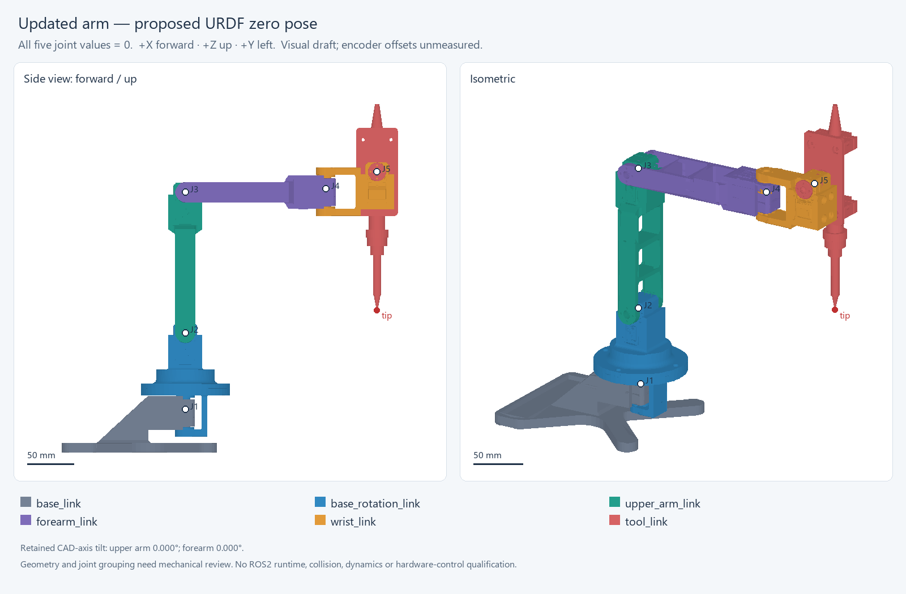

# R02 arm URDF handoff — aligned calibration reference

The completed package is
[`ros2_ws/src/joint_effort_arm_calibration_description`](ros2_ws/src/joint_effort_arm_calibration_description).
It contains the updated holder and mock iron, six SI-meter STL meshes, five
revolute joints, a fixed iron-tip frame, and an RViz display launch for ROS2 Jazzy.

## Start the model

From the repository root, inside the team's Ubuntu/Jazzy environment:

```bash
cd JointEffort-ROS2-V1/ros2_ws
./scripts/with_ros.sh colcon build --symlink-install --base-paths src --packages-select joint_effort_arm_calibration_description
./scripts/with_ros.sh ros2 launch joint_effort_arm_calibration_description display.launch.py
```

All joint sliders start at zero. This display launch has no motor driver.
The current `run_real.sh` / MoveIt setup continues to use the existing model.
Start the display independently of an existing arm launch so model and
joint-state publishers do not compete in the same ROS domain.

## R02 zero pose

- Fixed base level, with +Z up, +X forward and +Y left.
- Rotating upper bracket aligned with the fixed motor-mount bracket.
- Upper link vertical, forearm horizontal forward, wrist centered as pictured,
  and iron pointing down.


