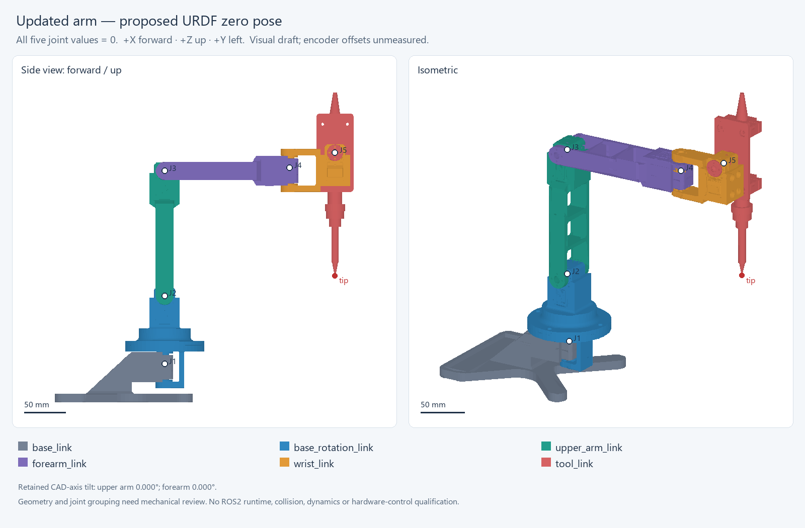

# Joint Effort arm calibration description — R02

ROS2 Jazzy description of the five-servo arm with the revised holder and mock
soldering iron. All five joint values equal zero in the pictured reference pose:
base brackets aligned, upper link vertical, forearm horizontal forward, iron down.
+X is fixed-base forward, +Y left, +Z up. Geometry uses **meters**.



R02 corrects the source assembly's retained 30.340072-degree base clocking. Both
the base visual and collision origins contain the required rotation; keep them.
The reference CAD is a static six-part assembly. This URDF supplies five revolute
joints and a fixed `iron_tip` frame.

## Display in the team's Jazzy workspace

From the repository root, in the team's Ubuntu/Jazzy environment:

```bash
cd JointEffort-ROS2-V1/ros2_ws
./scripts/with_ros.sh colcon build --symlink-install --base-paths src --packages-select joint_effort_arm_calibration_description
./scripts/with_ros.sh ros2 launch joint_effort_arm_calibration_description display.launch.py
```

For a standard Jazzy installation outside the team's wrapper:

```bash
source /opt/ros/jazzy/setup.bash
cd ~/ros2_ws
rosdep install --from-paths src --ignore-src -r -y
colcon build --packages-select joint_effort_arm_calibration_description
source install/setup.bash
ros2 launch joint_effort_arm_calibration_description display.launch.py
```

The launch starts robot_state_publisher, joint-state sliders at zero, and RViz.
It does not connect to motors. Keep the entire package, including its six meshes.

## Hardware calibration and integration

The controller stack now uses this geometry through the generated
`joint_effort_iron/urdf/iron.urdf`. See [R02-INTEGRATION.md](../../R02-INTEGRATION.md)
for the name mapping, collision model and mock tests, and
[REAL-ARM.md](../../REAL-ARM.md) for physical calibration.

This source package retains the descriptive names `base_rotation_joint`, `shoulder_joint`,
`elbow_joint`, `wrist_yaw_joint` and `wrist_pitch_joint`. The running controller model maps them
in that order to `joint_1` through `joint_5`.

The active motor map is `joint_effort_iron/config/sts_calibration.yaml`. The JSON template in
this source package is a reference; it is not read by the real-arm launch. Earlier bench
measurements use a different zero reference. Measure the assembled arm against R02 and fit
`calibration/r02-measurements.csv` with `tools/fit_r02_calibration.py`.

The +/-30-degree limits, 0.1 Nm effort and 0.25 rad/s velocity in this URDF are
**display placeholders**. Establish real travel and cable clearances before
motor operation. No inertial parameters are supplied for dynamics simulation.
The nominal iron TCP uses the CAD mock's photo-derived reference and still needs
physical measurement.

## Geometry and validation scope

This handoff preserves the validated R02 CAD snapshot. The later `main` CAD file
changes reviewed at `57207ad` have not been compared geometrically or merged into
it. Do not infer that this package represents those newer files.

The CAD includes the earlier proposed shallow shoulder/elbow cradle-floor
reliefs. Confirm printed motor seating and screw engagement physically. Small
pre-existing case/mount overlaps inside the fixed base link remain unqualified.

Saved native CAD placements, all 104 source-instance transforms, base alignment,
mesh units/winding/bounds, and 31 independent kinematic configurations passed.
The new base-angle check covers 120 fixed-to-moving external component pairs;
all five native intersection candidates had zero overlap. Moving-to-moving
geometry is unchanged from the previously checked R01 reference. Internal servo
contacts and dynamic motion clearance are outside that static check.

See `evidence/calibration-checks.json`, `evidence/provenance.json`,
`evidence/zero-convention.json`, and `evidence/zero-datums.csv` for the numerical
records. These establish CAD/software consistency, not physical calibration
accuracy. The integrated runtime has passed mock tests recorded in `../../reports/r02/`.
Physical R02 motor motion and calibration remain unverified.
